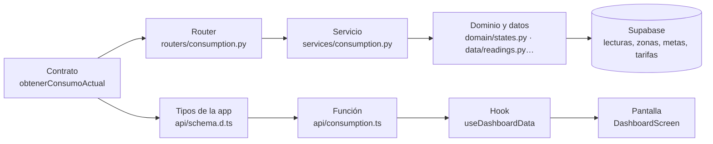

# Guía del equipo · estructura del repositorio y forma de trabajar

**12/11/2026** · Versión 1, después de la refactorización (PR 1 a 8). Reemplaza la guía de revisión de los PR (tarea #37 de `docs/PENDIENTES-DE-REFACTORIZACION.md`).

Esta guía explica, en palabras sencillas, dónde está cada cosa, cómo arrancar el proyecto en tu equipo y cómo se trabaja el backend, la app y la conexión entre los dos. Las reglas completas siguen en `CLAUDE.md` (raíz, `api/` y `app/`); si algo de aquí choca con ellas, ganan ellas.

---

## 1. El repositorio de un vistazo

Zentheris tiene tres partes que hablan entre sí, en este orden:

```
app (Expo)  →  API (FastAPI, Render)  →  Supabase (base de datos, Auth y Storage)
```

La app **solo** habla con Supabase para iniciar sesión y subir la foto de perfil. Todo lo demás pasa por la API.

### Árbol comentado

```
Zentheris-Prototype/
├── CLAUDE.md                  reglas permanentes del proyecto (léelo primero)
├── README.md                  presentación corta y por dónde empezar
├── .gitignore / .easignore    qué no sube git / qué no sube EAS (Satoshi sí entra en EAS)
├── .gitattributes             fija saltos de línea LF (evita diferencias falsas en Windows)
├── .github/workflows/tests.yml  CI: jobs «backend» y «app»
│
├── docs/                      FUENTES DE VERDAD (no se editan sin decisión del equipo)
│   ├── reglas/                reglas de negocio v4.9 (RN-*), tablas y pantallas
│   ├── api/                   contrato OpenAPI 0.2.5 (manda sobre la API y la app)
│   ├── decisiones/            registro de decisiones DC-*
│   ├── datos/                 umbrales de estado, motor de referencia y perfiles
│   ├── textos/                catálogo de textos es-CO (app, backend y Supabase)
│   ├── diseno/                tokens y fichas de los componentes
│   ├── supabase/              especificación de tablas, RLS, Storage y variables
│   ├── historias/ pruebas/    historias de usuario y matriz de pruebas
│   ├── guias/                 guías para personas (esta incluida)
│   ├── MAPA-DE-INTEGRACION.md una fila por endpoint: contrato → API → app → pantalla
│   ├── PENDIENTES-DE-REFACTORIZACION.md   tareas de código pendientes
│   └── PENDIENTES-DE-CONFIGURACION.md     ajustes de GitHub y Render pendientes
│
├── api/                       BACKEND (FastAPI + Python 3.14, con uv)
│   ├── app/
│   │   ├── main.py            crea la app y monta los routers en /api/v1
│   │   ├── config.py          lee las variables de entorno
│   │   ├── errors.py          errores {codigo, mensaje, detalles}
│   │   ├── security/          JWT de Supabase, usuario actual, membresía y permisos
│   │   ├── schemas/           modelos Pydantic iguales al contrato (campos en español)
│   │   ├── routers/           un archivo por etiqueta del contrato; solo validan y llaman al servicio
│   │   ├── services/          casos de uso (la lógica de cada endpoint)
│   │   ├── domain/            código puro: simulador, estados, historial, reglas de zonas y alertas
│   │   ├── data/              consultas a la base, un archivo por grupo de tablas
│   │   └── config_files/      copias exactas de umbrales y textos del backend
│   ├── tests/                 pruebas por grupo de la matriz (contrato, permisos, RLS…)
│   ├── .env.example           plantilla de variables (se copia como api/.env)
│   └── pyproject.toml, uv.lock
│
├── app/                       APP MÓVIL (Expo SDK 57, React Native, TypeScript)
│   ├── src/
│   │   ├── app/               rutas de expo-router (nombres en español); solo enrutan
│   │   ├── screens/           pantallas: <Pantalla>/<Pantalla>.tsx + use<Pantalla>Data.ts
│   │   ├── components/        componentes del sistema de diseño (solo presentación)
│   │   ├── theme/             tokens.ts (GENERADO) y fonts.ts
│   │   ├── texts/             catálogo es-CO + t() y plural()
│   │   ├── format/            formatos es-CO: números, kW, kWh, COP, %, tiempo relativo
│   │   ├── api/               cliente HTTP + funciones por endpoint + schema.d.ts (GENERADO)
│   │   └── state/             React Query (queryClient, queryKeys) y sesión de Supabase
│   ├── assets/fonts/          Inter y JetBrains Mono (en git) · satoshi/ (NO va en git)
│   ├── scripts/               generate-tokens.mjs
│   └── .env.example           plantilla de variables (se copia como app/.env)
│
├── supabase/
│   ├── migrations/            6 migraciones numeradas (nunca se editan; se agregan nuevas)
│   └── types/                 tipos de referencia de la base
│
└── scripts/
    └── check_integration.py   comprueba que contrato, API, app y mapa coincidan
```

### ¿Dónde va cada cosa?

| Quiero… | Va en… | Ojo con… |
|---|---|---|
| Cambiar un endpoint o un campo | `docs/api/zentheris-api-v0.2.5.yaml` **primero** (decisión del equipo) | No se inventan endpoints ni campos |
| Un modelo de respuesta o petición | `api/app/schemas/<etiqueta>.py` | Mismos nombres, tipos y nulos que el contrato |
| La entrada de un endpoint | `api/app/routers/<etiqueta>.py` | Solo valida y llama al servicio |
| La lógica de un endpoint | `api/app/services/<etiqueta>.py` | Comprueba membresía, rol y permiso |
| Un cálculo puro (estados, simulador…) | `api/app/domain/` | Sin FastAPI ni SQL |
| Una consulta a la base | `api/app/data/<grupo>.py` | Inserciones por lotes |
| Una tabla o columna nueva | `supabase/migrations/` (migración **nueva**) | Nunca editar una migración aplicada |
| Una prueba del backend | `api/tests/<grupo>/` | Nombre con el código de la matriz (P-02, C-01…) |
| Una pantalla | `app/src/screens/<Pantalla>/` + su ruta en `app/src/app/` | La ruta solo enruta |
| Un componente visual | `app/src/components/` | Nombre y props de `docs/diseno/componentes/index.d.ts` |
| Un texto visible | `docs/textos/catalogo.es-CO.json` → copia en `app/src/texts/` | Nunca texto escrito a mano en la interfaz |
| Un color, espacio o tamaño | `docs/diseno/tokens.json` → `npm run generate:tokens` | `tokens.ts` no se edita a mano |
| Una clave o contraseña | `api/.env` / `app/.env` en tu equipo y en los paneles de Render, Supabase y EAS | **Nunca** en git: el repositorio es público |

---

## 2. Cómo arrancar en tu equipo

Necesitas: Git, [uv](https://docs.astral.sh/uv/) (instala Python 3.14 solo), Node 24 y la app Expo Go o un emulador.

1. **Clonar:**
   ```bash
   git clone https://github.com/Thomasvtf/Zentheris-Prototype.git
   cd Zentheris-Prototype
   ```
   Si ya lo tenías, entra a tu rama y trae lo nuevo: `git switch <tu-rama>` y `git pull`.
2. **Variables de entorno:** copia las plantillas y rellénalas con los valores de la guía de claves (pídelos al equipo; nunca por un canal público):
   ```bash
   cp api/.env.example api/.env
   cp app/.env.example app/.env
   ```
   En `app/.env` todo lo que empieza por `EXPO_PUBLIC_` queda dentro de la app y cualquiera puede leerlo: ahí nunca va una clave secreta.
3. **Instalar Satoshi** (obligatoria para los títulos; no está en git por su licencia, DC-06):
   1. Entra a [fontshare.com/fonts/satoshi](https://www.fontshare.com/fonts/satoshi) y descarga la familia (es gratis).
   2. Copia `Fonts/OTF/Satoshi-Bold.otf` en `app/assets/fonts/satoshi/Satoshi-Bold.otf`, con ese nombre exacto.
   3. Si te falta, al correr la app en desarrollo verás en la consola el aviso `[fonts] Falta …` y los títulos saldrán en Inter Bold.
4. **Correr la API** (desde `api/`):
   ```bash
   uv sync
   uv run uvicorn app.main:app --reload
   ```
   Abre `http://localhost:8000/docs`. `GET /api/v1/salud` responde; los demás endpoints responden **501** hasta su sesión (es el esqueleto).
5. **Correr la app** (desde `app/`):
   ```bash
   npm ci
   npx expo start --clear
   ```
   En desarrollo, la ruta `/catalogo-componentes` muestra tokens, fuentes (dice «Satoshi sí» si la instalaste bien), íconos, formatos y gráficos de prueba.

---

## 3. Cómo se trabaja el backend

Cada endpoint sigue siempre el mismo camino. Hazlo en este orden:

1. **Contrato.** Busca la operación en `docs/api/zentheris-api-v0.2.5.yaml` (su `operationId`, parámetros, respuesta y errores). Si falta algo, no lo inventes: deja `TODO(pendiente: …)` y pregúntalo en el PR.
2. **Schemas.** Los modelos ya existen en `api/app/schemas/` con los nombres del contrato. Solo se tocan si el contrato cambia.
3. **Router.** Ya existe en `api/app/routers/<etiqueta>.py`, con la ruta, el `operation_id` y los errores. Solo valida la entrada y llama al servicio.
4. **Servicio.** En `api/app/services/<etiqueta>.py` reemplaza `raise NotImplementedOperation("<operationId>")` por la lógica real. Aquí se comprueba en **cada** llamada la membresía activa, el rol y el permiso (RLS es la segunda defensa, no la primera). Antes de responder consumo, historial, fuentes o alertas se completan las horas faltantes (`services/hour_recovery.py`).
5. **Dominio y datos.** Los cálculos van en `api/app/domain/` (código puro y probado) y las consultas en `api/app/data/`.
6. **Prueba.** En `api/tests/<grupo>/`, con el código de la matriz (`docs/pruebas/`). Todas las respuestas llevan además C-01 (respuesta igual al esquema).
7. **Mapa.** Revisa que la fila del endpoint en `docs/MAPA-DE-INTEGRACION.md` siga siendo cierta (tablas, prueba, textos). Si cambias un nombre de función, cambia también la fila: el CI lo comprueba.

Errores: siempre `{codigo, mensaje, detalles}`, con `codigo` del enum `CodigoError`. Sin membresía → 404; sin permiso → 403 con el código exacto. Nunca se devuelve el texto de una excepción interna.

---

## 4. Cómo se trabaja la app

| Pieza | Dónde | Cómo se usa |
|---|---|---|
| **Tokens** | `app/src/theme/` | `import { colors, spacing, typography } from '@/theme'`. Se regeneran con `npm run generate:tokens` desde `docs/diseno/tokens.json`. Rojo y amarillo solo para severidad; el pico usa `chart-peak` |
| **Fuentes** | `app/src/theme/fonts.ts` | `fontFamilyFor('display', '700')` da Satoshi (o Inter Bold si falta). La carga al arrancar toda la app es la tarea #42 |
| **Textos** | `app/src/texts/` | `t('comun.sin_dato')`, `t('clave', { nombre })` y `plural('clave', n)`. Todo texto visible sale del catálogo |
| **Formatos es-CO** | `app/src/format/` | `formatNumber(v, 2)` para kW, `formatNumber(v, 1)` para kWh, `formatCOP(v)`, `formatPercent(v)` («34 %»), `relativeTime(fecha)`. `null` se muestra como «sin dato», nunca como 0 |
| **Cliente API** | `app/src/api/` | Una función por endpoint, con su etiqueta `@operationId` (por ejemplo `getCurrentConsumption(hogarId)`). Los tipos salen de `schema.d.ts`, que se regenera con `npm run generate:api-types` |
| **Hooks de datos** | `app/src/screens/<Pantalla>/use<Pantalla>Data.ts` | React Query con `queryKey('<operationId>', ...parámetros)` de `app/src/state/queryKeys.ts`. Los hooks se crean desde la sesión 9 |
| **Pantallas** | `app/src/screens/<Pantalla>/<Pantalla>.tsx` | Usan su hook y los componentes del sistema de diseño. La ruta en `app/src/app/` solo la muestra |
| **Catálogo** | `/catalogo-componentes` | Solo en desarrollo: sirve para ver tokens, fuentes, íconos, formatos y gráficos sin montar pantallas |

Para agregar una librería: `npx expo install <paquete>` (elige la versión compatible con el SDK).

---

## 5. Cómo se conectan: un endpoint de punta a punta

Ejemplo: las tarjetas del Panel principal, **`GET /hogares/{hogar_id}/consumo/actual`** (`obtenerConsumoActual`, fila 27 del mapa).



| Paso | Archivo | Qué hay hoy |
|---|---|---|
| Contrato | `docs/api/zentheris-api-v0.2.5.yaml` | La operación con su respuesta `ConsumoActualHogar` y los errores 401, 403 y 404 |
| Schema | `api/app/schemas/consumption.py` | `ConsumoActualHogar` con `hora`, `actual` (`potencia_kw`, `costo_cop`, `estado`…) y `acumulado_hoy` |
| Router | `api/app/routers/consumption.py` | `get_current_consumption(hogar_id, user)` llama a `service.get_current_consumption(user.id, hogar_id)` |
| Servicio | `api/app/services/consumption.py` | Responde 501 (`TODO(obtenerConsumoActual)`) hasta su sesión |
| Dominio y datos | `services/hour_recovery.py`, `domain/states.py`, `data/readings.py`, `data/goals.py`, `data/tariffs.py` | Esqueletos |
| Pruebas | `api/tests/permissions/test_p02_no_view_consumption_403.py` y otras (P-02, P-06, B-04, U-01) | Marcadas como omitidas hasta su sesión |
| App: tipos | `app/src/api/schema.d.ts` | Generados del contrato |
| App: función | `app/src/api/consumption.ts` | `getCurrentConsumption(hogarId)`, con `@operationId obtenerConsumoActual` |
| App: hook | `useDashboardData` (previsto) | Usará `queryKey('obtenerConsumoActual', hogarId)` |
| App: pantalla | `DashboardScreen` (prevista, con `ConsumptionGauge` o `ConsumptionRing`) | Textos `panel.*`, `estado.consumo_actual.*`, `estado.acumulado.*` |

Lo importante: el **mismo `operationId`** une todas las piezas. Si cambias el nombre de una función, cámbialo también en el mapa; `check_integration.py` avisa si algo no coincide.

---

## 6. Pruebas, CI y `check_integration`

**En tu equipo, antes de subir:**

| Dónde | Comando |
|---|---|
| `api/` | `uv run ruff check .` (estilo) · `uv run pytest` (pruebas) · `uv run python ../scripts/check_integration.py` |
| `app/` | `npm run typecheck` · `npm test` |

**El CI** (`.github/workflows/tests.yml`) corre en cada PR y en cada push a `main`, con dos jobs:
- **backend:** `ruff`, `pytest` con cobertura, `check_integration.py` y el lint oficial del contrato (Redocly).
- **app:** `npm ci`, typecheck, pruebas de formatos y textos, tokens al día con `tokens.json`, tipos de la API al día con el contrato y empaquetado de Android (`expo export`).

**`scripts/check_integration.py`** tiene dos partes:
- **Parte A:** las copias (`api/app/config_files/` y `app/src/texts/catalogo.es-CO.json`) deben ser idénticas byte a byte a sus originales de `docs/`. Si cambias un texto o un umbral, cámbialo en `docs/` y vuelve a copiarlo.
- **Parte B:** las 40 operaciones del contrato, los routers, los servicios, las funciones de la app (`@operationId`) y el mapa deben coincidir.

El PR no se fusiona si el CI está en rojo.

---

## 7. Ramas, commits y PR

**Ramas:**
- Cortas, desde `main`: `<tipo>/<descripcion>` con tipo `feat`, `fix`, `docs`, `refactor`, `build`, `ci` o `test` (sin `chore`).
- Las ramas personales siguen como `<Persona>/feat-<Tema>`.
- Nunca commit directo a `main`.

**Commits:** `tipo(alcance): descripción`, con el tipo en inglés y la descripción en español. Ejemplo: `feat(api): calcular el consumo actual del hogar`. Sin atribución a herramientas (`Co-Authored-By`, «Generated with…»).

**PR:**
- Un PR por historia o por fase. En la descripción: reglas RN, endpoints y decisiones DC que cubre; qué se probó y qué no (por ejemplo, «no probado en iOS»).
- **Los PR hacia `main` los aprueba otra persona del equipo (DC-61).** Quien abre el PR no se aprueba a sí mismo.
- Fusionar siempre con **«Create a merge commit»**, nunca «Squash» ni «Rebase» (DC-68).
- Borrar la rama después de fusionar.

**PR en cadena** (cuando un PR depende de otro: cada uno apunta a la rama del anterior y dice «Depende de #N»):
1. Fusionar el primero hacia `main` con merge commit, **sin** borrar todavía su rama.
2. **Cambiar la base del siguiente a `main`** (en GitHub: «Edit» junto al título del PR, o `gh pr edit <N> --base main`) y comprobar que quedó abierto.
3. **Después** borrar la rama fusionada.
4. Esperar el CI de `main` en verde y seguir con el siguiente.

Si se borra la rama antes de cambiar la base, GitHub **cierra** el PR siguiente en vez de moverlo a `main`. Pasó el 12/11/2026 con el PR #2, y hubo que recuperarlo.

**Hecho significa:** código + pruebas en verde en el CI + reglas citadas + revisión de otra persona. Si tiene interfaz: probado en Android y en iOS, o declarado como no probado.

---

## 8. Pendientes abiertos que afectan al equipo

| # | Qué falta | Cuándo | Qué significa para ti |
|---|---|---|---|
| **#29** | Decidir los códigos de error del 500 y del 401 (`CodigoError` no tiene uno genérico). La propuesta es agregar `ERROR_INTERNO` y `NO_AUTENTICADO` en el contrato 0.2.6 | Antes de implementar la seguridad (sesión 3) | No inventes códigos de error: espera la decisión |
| **#32** | Igualar las versiones de parche de Expo con las de las ramas del equipo y dejar `expo-doctor` en 21 de 21 (Expo publicó la 57.0.33 el 12/11) | Pendiente | Si `expo-doctor` marca 1 falla de versiones, es esto; no subas versiones por tu cuenta |
| **#39** | Color del texto de la píldora «Pico»: las fichas se contradicen (rojo claro o `text/primary`) | Al construir `PeakMarker` | No cambies la ficha sin aprobación de Nicolás |
| **#40** | `app-tabs.web.tsx` (plantilla de Expo) apunta a `/explore`, que no existe; `tsc` falla si antes corrió `expo start` | Junto con la limpieza de la plantilla (#15) | Si `npm run typecheck` falla por `/explore`, es esto |
| **#42** | Cargar las fuentes al arrancar la app, en el `_layout.tsx` raíz (`useFonts(fontFiles)`). Hoy solo las carga el catálogo | Antes de usar los estilos de título (`display-*`) en cualquier pantalla (a más tardar en la sesión 10) | **Ninguna pantalla puede usar `display-*` sin esta tarea hecha** |

Ajustes de GitHub y Render pendientes (para Thomas y para quien cree el servicio): `docs/PENDIENTES-DE-CONFIGURACION.md`.
